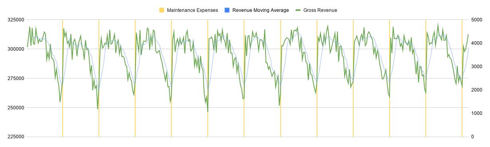

# Factory Logistics & Production Yield Analysis

A 365-day discrete-event simulation modeling photolithography manufacturing operations, material restock logistics, and yield degradation economics using Python, SQLite, and Google Sheets.

[📊 View Interactive Financial Model & Master Sheet](https://docs.google.com/spreadsheets/d/1bTv-0qY5kamyjO0SX6YIfkRFZP48bxFq_EOMrJ0pFyM/edit?usp=sharing)

---

## Executive Summary: Maintenance Optimization
An analysis of daily production data revealed a severe operational bottleneck in scheduled preventative maintenance.

* **Current Baseline (30-Day Cycle):** Yield decays by 1% per day between Days 16–30, creating a cumulative annual loss of **$3.02M in Grade-A chip revenue** to save $45,000 in maintenance fees.
* **Optimized Strategy (17-Day Cycle):** Shifting maintenance to Day 17 requires ~9 additional service events annually (+ $45,000 in service costs) but fully recovers **$2.97M in net profit**.
* **Capital Leverage:** The plant can spend up to **$140,847 per maintenance session** (over 28x the current $5,000 vendor fee) and remain net cash-positive.

---

## Technical Proof & Financial Modeling

### Daily Yield Decay & Incremental Losses
* **Optimal Baseline (Days 1–15):** At 0% performance decay, daily Grade-A output averages 210 units (300 units $\times$ 70% yield). At $1,000/unit, optimal production generates $210,000/day in Grade-A revenue.
* **Degradation Phase (Days 16–30):** Expected Grade-A output drops by 1% per day starting on Day 16. Each day of decay costs an additional $2,100/day in lost expected value (1% $\times$ $210,000).
* **30-Day Trough:** By Day 30, Grade-A yield drops by 15% (178.5 units produced), creating a single-day loss of $31,500.

### Identifying the Optimal Maintenance Point (Day 17)
* **The Decision Rule:** Maintenance should occur as soon as cumulative yield loss exceeds the fixed $5,000 service fee.
* **Day 16 Loss:** $2,100 *(below $5,000 fee)*
* **Day 17 Loss:** $4,200 $\rightarrow$ **Cumulative Loss:** $2,100 + $4,200 = **$6,300** *(exceeds $5,000 fee)*
* **Optimal Trigger:** Day 17 is mathematically the exact point where deferring maintenance turns net-negative.

### Financial Impact: Current vs. Optimized Strategy
* **Cumulative Loss per 30-Day Cycle:** $\sum_{k=1}^{15} k = 120$ step-losses $\times$ $2,100 = $252,000 in lost yield per cycle.
* **Annual Cost of Inaction (30-Day Cycles):** Across 12 annual cycles, deferring maintenance forfeits $3,024,000/year in revenue while spending $60,000/year on service (12 $\times$ $5,000).
* **Optimized Strategy (17-Day Cycles):** Running ~21 maintenance events annually increases service costs to $105,000/year (+$45,000/year) but recovers the entire $3,024,000 in lost yield.
* **Net Annual Bottom-Line Impact:** Spending an additional $45,000/year yields a **$2,970,000 net annual profit increase**.

### Capital Sensitivity & Vendor Threshold
* **Breakeven Ceiling:** Recovering $3.024M in preserved yield across 21.47 maintenance events means the facility could spend up to **$140,847 per maintenance session** (over 28x the current $5,000 vendor rate) and remain net cash-positive.

---

## Data Architecture & Methods
* **Simulation Engine:** Built in Python to log daily multi-product yields, raw material burn rates, and financial ledger events.
* **Database Backend:** SQLite storage structured across relational tables (`daily_production_ledger`, `financial_ledger`, `raw_materials`).
* **Analytical Processing:** Custom SQL subqueries aggregating non-duplicated daily financial and yield summaries exported for financial modeling.

---

## Primary Visualizations

*Figure 1: 365-day daily gross revenue tracking showing sawtooth yield degradation curves and $5,000 maintenance resets.*