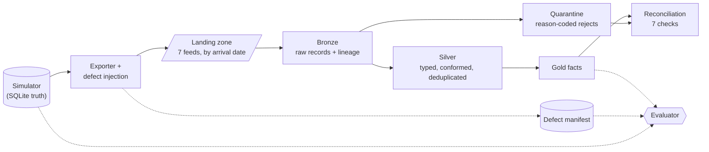
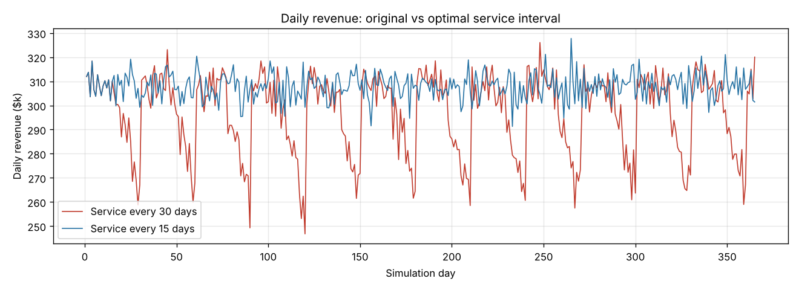
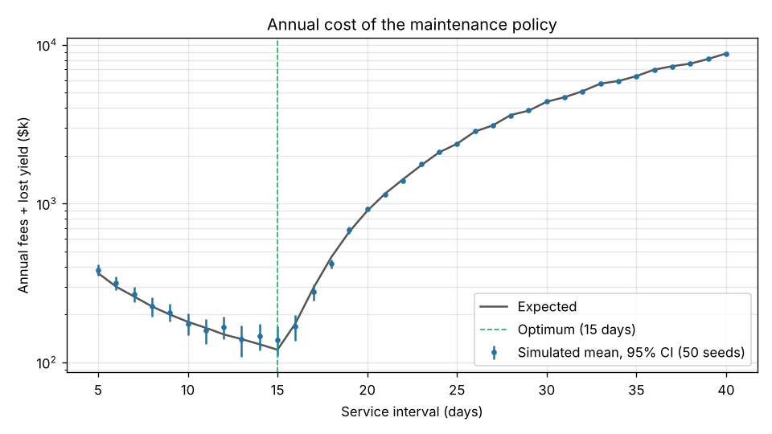

# FactorySim

[](https://github.com/IanMc108/FactorySim/actions/workflows/ci.yml)

A year-long simulation of a small semiconductor plant, and a **dirty-data ETL and reconciliation pipeline** that has to rebuild the plant's books from the messy files its systems export.

The simulator knows the true production, sales, purchases, maintenance and cash. An exporter renders that truth as the daily files five source systems would drop into a landing zone, then damages them with 13 kinds of labelled defect. The pipeline (Python and DuckDB SQL over Parquet) loads, cleans, deduplicates, quarantines and reconciles those files without ever seeing the truth. An evaluator then scores the result against the truth, record by record.

The simulator also answers an operations question on its own: [how often to service the lithography lines](#maintenance-analysis).

Every number in this README is generated by `factorysim report` from fixed seeds, and a test fails if the README and the code disagree.

## The pipeline



Dotted lines are scoring only: the pipeline code cannot import the simulator or exporter, and a test enforces that.

### Source feeds

| Feed | System | Format | What makes it awkward |
|---|---|---|---|
| `mes_production` | MES (shop floor) | CSV, daily | Schema v2 from 2025-07-01: renamed columns, UTC timestamps instead of plant-local, shifts `1/2/3` instead of `A/B/C`. The night shift crosses midnight. Quoted multi-line comments. |
| `mes_material_issues` | MES | CSV, daily | Plant-local timestamps |
| `erp_invoices` | ERP | CSV, UTF-8 with BOM, CRLF | Money as text in four formats (`$1,000.00`, `1,000.00`, `1000.00`, `1000`); `MM/DD/YYYY` or ISO dates; credit memos |
| `erp_goods_receipts` | ERP | CSV | Wafers sometimes received in boxes of 25 |
| `erp_stock_snapshots` | ERP | CSV, weekly | |
| `cmms_work_orders` | Maintenance system | JSON lines | Nested cost object; timestamps with UTC offsets; repeated status events |
| `bank_statements` | Bank | CSV, Windows-1252 | No transaction IDs; separate debit and credit columns; an opening `BALANCE FORWARD` line; references buried in free text |

A few lines of each are in [`docs/samples/`](docs/samples/), re-encoded as UTF-8 for display.

### Injected defects

| Defect | Feeds | What it simulates | What the pipeline does |
|---|---|---|---|
| `duplicate_file` | all | A file re-delivered days later | Skips it by SHA-256 against the ingest log |
| `late_file` | all | A file arriving 1–4 days after its business date | Loads it in a later batch; reconciles by business date, not arrival date |
| `header_repeat` | CSV feeds | Concatenated exports, with the header line repeated mid-file | Drops it at bronze |
| `duplicate_row` | MES | At-least-once delivery: the same row twice, in the same or the next day's file | Deduplicates on `event_id` |
| `corrected_resend` | MES | A row re-sent the next day with a corrected quantity | Keeps the highest revision |
| `code_variant` | MES, ERP | Lower-case, padded or legacy station and SKU codes | Normalizes them and maps them through alias tables |
| `uom_box` | goods receipts | Quantities in boxes of 25 | Converts them to units via the UoM table |
| `duplicate_wo_event` | maintenance system | A completion event sent twice | Deduplicates on work order, event and timestamp |
| `reversed_invoice` | ERP | An invoice keyed twice, then reversed with a credit memo | Keeps both. It is a real pair of business transactions that nets to zero, not a data duplicate. |
| `malformed_row` | MES, ERP | A truncated row or a non-numeric quantity | Quarantines it |
| `unknown_code` | ERP | A SKU typo that is not in the alias table | Quarantines it as `unknown_sku` and never guesses |
| `missing_key` | ERP | A blank document number | Quarantines it |
| `double_keyed_line` | ERP | A line entered twice under a new line number: a genuine billing error that no row-level rule can see | Reconciliation flags it (production vs. sales, and invoices vs. bank deposits) |

### Results

<!-- etl:begin (generated by `factorysim report --section etl`; do not edit) -->

One year of exports: 1,685 files and 24,650 records. The pipeline loaded 1,651 files and skipped 34 re-delivered duplicates.

| Defect | Injected | Handled | How |
|---|---:|---:|---|
| `duplicate_file` | 34 | 34 | re-delivered file skipped by content hash |
| `late_file` | 81 | 81 | loaded in a later batch; its business date's gold numbers match the truth |
| `header_repeat` | 40 | 40 | repeated header dropped, nothing else quarantined |
| `duplicate_row` | 54 | 54 | one silver row per event id; the production total matches the truth |
| `corrected_resend` | 22 | 22 | revision 2 wins over revision 1; the production total matches the truth |
| `code_variant` | 3,688 | 3,688 | mapped through the alias tables (maintained reference data; a code missing from them is the unknown_code case) |
| `uom_box` | 34 | 34 | boxes of 25 converted to each |
| `duplicate_wo_event` | 3 | 3 | one completion event survives; the work order's cost matches the truth |
| `reversed_invoice` | 40 | 40 | duplicate invoice and credit memo both kept; the day's sales match the truth |
| `malformed_row` | 24 | 24 | quarantined with a reason |
| `unknown_code` | 8 | 8 | quarantined as unknown_sku |
| `missing_key` | 4 | 4 | quarantined as missing_key |
| `double_keyed_line` | 6 | 6 | not row-detectable; reconciliation reports it as an exception |

**Quarantine:** 36 records quarantined; precision 100% and recall 100% against the injected unrecoverable records, 36 of 36 with the expected reason code.

| Reconciliation check | Rows | Matched | Explained by quarantine | Open (late window) | Exceptions |
|---|---:|---:|---:|---:|---:|
| `bank_balance_continuity` | 517 | 517 | 0 | 0 | 0 |
| `customer_receipts` | 365 | 342 | 17 | 1 | 5 |
| `inventory_roll_forward` | 156 | 156 | 0 | 0 | 0 |
| `maintenance_payments` | 12 | 12 | 0 | 0 | 0 |
| `mass_balance` | 2,190 | 2,172 | 18 | 0 | 0 |
| `production_vs_sales` | 1,460 | 1,424 | 30 | 1 | 5 |
| `supplier_payments` | 140 | 140 | 0 | 0 | 0 |

12 of 12 checks touched by an injected billing error report it (10 as exceptions, 2 still open inside the late-arrival window at the end of the year); 0 are hidden as "explained". Exceptions that are not injected errors: 0.

**Gold vs. ground truth** (cells compared against the simulator's database):

| Dataset | Cells | Exact | Differs only by injected losses | Unexplained |
|---|---:|---:|---:|---:|
| production units | 5,020 | 5,002 | 18 | 0 |
| material issue units | 2,190 | 2,190 | 0 | 0 |
| sales units | 1,460 | 1,436 | 24 | 0 |
| sales revenue | 1,460 | 1,436 | 24 | 0 |
| goods receipts units | 140 | 140 | 0 | 0 |
| maintenance cost | 12 | 12 | 0 | 0 |
| bank closing balance | 365 | 365 | 0 | 0 |
| stock snapshots | 159 | 159 | 0 | 0 |

**The same run for 8 defect seeds** (each injects a different set of defects; the tables above are seed 7):

| Seed | Defects handled | Quarantine P / R | Billing errors reported | Masked | Unexpected exceptions | Unexplained cells |
|---:|---:|---:|---:|---:|---:|---:|
| 1 | 4,121 / 4,121 | 100% / 100% | 6 / 6 | 0 | 0 | 0 |
| 2 | 4,181 / 4,181 | 100% / 100% | 12 / 12 | 0 | 0 | 0 |
| 3 | 4,175 / 4,175 | 100% / 100% | 8 / 8 | 0 | 0 | 0 |
| 4 | 4,091 / 4,091 | 100% / 100% | 10 / 10 | 0 | 0 | 0 |
| 5 | 4,115 / 4,115 | 100% / 100% | 12 / 12 | 0 | 0 | 0 |
| 6 | 4,121 / 4,121 | 100% / 100% | 10 / 10 | 0 | 0 | 0 |
| 7 | 4,038 / 4,038 | 100% / 100% | 12 / 12 | 0 | 0 | 0 |
| 8 | 4,067 / 4,067 | 100% / 100% | 8 / 8 | 0 | 0 | 0 |

<!-- etl:end -->

### How it works

- **Bronze keeps everything.** Every record of every accepted file version is stored untyped, including the ones that do not parse. Each one carries its file, SHA-256, arrival date, business date, ingest sequence and record number, so silver can always be rebuilt and any gold number can be traced back to a line in a file.
- **File versions, not just files.** A file is identified by its path and content hash:
  - a re-delivered copy is skipped;
  - a file re-issued under the same name, whether overwritten in place or re-sent later, replaces every record of the old version;
  - a file that cannot be read (bad name, undecodable bytes) is logged as rejected while the rest of the batch carries on.

  Each file's bronze data and log entry are committed atomically, and crash leftovers are cleaned up on the next run.
- **Incremental and idempotent.** Each run recomputes silver from bronze, fingerprints every monthly partition and rewrites only the months whose content changed. It also deletes months left empty, so a correction that moves a record from May to June fixes both months. Gold and reconciliation are small and are rebuilt in full. Tests run the year in uneven batches and compare against one full run, and re-running with no new files changes nothing.
- **Deduplication removes copies, not transactions.** Records with the same natural key collapse to the newest extract, or the highest revision where the feed has one. A credit memo that reverses a duplicate invoice stays, and a billing error surfaces in reconciliation rather than being silently "fixed".
- **Quarantine instead of drop or guess.** Every rejected record keeps its raw text and gets a reason code. Numbers are parsed strictly: `10.5`, `1e3` and `1_000` are rejected, never rounded.
- **Explanations must add up.** A reconciliation variance counts as *explained by quarantine* only when it equals the effect of the related quarantined records, matched by station, SKU or reference. The pipeline recovers a lost record's size where it can, for example from the station's material issues. Variances within 7 days of the latest arrival are *open*, because late files may still come. Anything else is an *exception*.
- **Time is explicit.** Plant-local MES timestamps (America/Chicago, DST included) are converted to UTC, and post-midnight night-shift events belong to the production day the shift started on.
- **Transformations are SQL-first.** The SQL lives in versioned [`.sql` files](factorysim/etl/sql/), and Python only handles ingestion and orchestration.

**What the scorecard does and does not prove:** it grades the pipeline against defects the same project injects. Two things guard against that being circular:
- every check verifies an outcome against the truth (for example, that the late file's day has correct gold numbers), not just that a mechanism ran;
- the pipeline is also tested on hand-made hostile inputs outside the exporter's catalog ([`tests/test_etl_hostile.py`](tests/test_etl_hostile.py)), which came from an [adversarial review](docs/review-log.md).

More detail, including the lake layout, the run model, the AWS mapping and the known limits, is in [docs/etl-design.md](docs/etl-design.md).

### Running it on AWS

The lake is plain Parquet in S3-style prefixes, so each piece maps directly onto AWS:

| Here | On AWS |
|---|---|
| `build/landing/<feed>/YYYY/MM/DD/` | S3 landing bucket, by arrival date |
| `ingest.py` and the ingest log | Glue Python shell job (or a Lambda on S3 events) writing bronze and the control table |
| `sql/silver/*.sql` run in DuckDB | Glue Spark jobs with dynamic partition overwrite; job bookmarks pick out the new files |
| `catalog.duckdb` views | Glue Data Catalog tables over the same prefixes |
| gold and reconciliation SQL | Athena queries or views |
| `factorysim etl` | Step Functions or a Glue workflow, triggered on arrival |

[`aws/glue/silver_production_events.py`](aws/glue/silver_production_events.py) is the MES silver step ported to a Glue 5.0 (Spark 3.5) job. `tests/test_glue_parity.py` runs it on local Spark over a real bronze table and asserts that it produces exactly the rows the DuckDB pipeline does. Nothing here has been deployed to AWS.

## Maintenance analysis

The lithography lines process 300 wafers a day. Fresh after service, each wafer becomes a Grade-A die 70% of the time, Grade-B 20% and scrap 10%. After 15 days without service, Grade-A yield falls by one percentage point per day, and the lost share becomes scrap. A service costs a flat fee and restores full yield overnight.

Servicing more often costs more in fees; servicing less often loses Grade-A dies. For a service interval of *T* days, one cycle costs the fee plus the expected revenue lost on days 16 to *T*. The best interval minimises cost per day across the cycle: keep stretching the cycle only while the next day's expected loss is smaller than the cycle's average daily cost so far.

With a $5,000 fee, the first day of decay already loses $3,000, against an average cost of $333/day for a 15-day cycle. So the answer is to **service every 15 days, just before decay starts**. The simulation agrees with the closed-form expected values within sampling noise.

<!-- results:begin (generated by `factorysim report`; do not edit) -->

Horizon: 365 days · service fee $5,000 · decay 1 pp/day after day 15 · 210 Grade-A dies/day at full yield · each point of decay costs $3,000/day

| Schedule | Services | Fees | Expected decay loss | Expected total |
|---|---:|---:|---:|---:|
| Every 30 days (original) | 12 | $60,000 | $4,320,000 | $4,380,000 |
| Every 17 days (original README's claim) | 21 | $105,000 | $189,000 | $294,000 |
| **Every 15 days (optimal)** | 24 | $120,000 | $0 | $120,000 |

- Moving from 30-day to 15-day service saves **$4,260,000/year** ($60,000 more in fees, $4,320,000 less lost yield).
- The 17-day schedule still loses $189,000/year to decay, so it leaves $174,000/year on the table versus the optimum.
- The optimum only moves when servicing gets expensive: 16-day service becomes optimal above $45,000 per visit, 17-day service becomes optimal above $93,000 per visit, 30-day service becomes optimal above $990,000 per visit.

**Simulation cross-check** (200 seeds per schedule; cost = fees + revenue shortfall versus a plant with no decay):

| Interval | Expected total | Simulated mean | Std. error | Difference |
|---:|---:|---:|---:|---:|
| 15 days | $120,000 | $123,687 | $7,559 | +0.5 SE |
| 16 days | $176,000 | $178,690 | $7,748 | +0.3 SE |
| 17 days | $294,000 | $290,822 | $7,144 | -0.4 SE |
| 20 days | $900,000 | $916,341 | $7,657 | +2.1 SE |
| 25 days | $2,380,000 | $2,373,645 | $7,584 | -0.8 SE |
| 30 days | $4,380,000 | $4,379,803 | $8,150 | +0.0 SE |

The largest gap is 2.1 standard errors. Across 6 independent rows, gaps of about 2 standard errors are normal sampling noise; a modelling error would show as gaps that grow with the amount of decay.

**Baseline run** (seed 42, 30-day service): revenue $108,328,700, material purchases $7,432,500, maintenance $60,000, closing cash $100,936,200, 0 station stoppages.

<!-- results:end -->





### Corrections to the first version

The first version of this project (v1.0) reached different conclusions. They were wrong, and this version replaces them:

- **v1 claimed the optimum was 17 days**, using the rule "service once cumulative decay loss exceeds the fee". That rule compares the wrong quantities. Under v1's own assumptions the optimum was 15 days, and 17 days only wins when a service costs more than about $93,000 (see the thresholds above).
- **v1 modelled decay as 1% of Grade-A output per day ($2,100/day per step)**, but its own simulated data decayed by 1 percentage point of yield per day ($3,000/day per step). v1 therefore understated the cost of the 30-day schedule by about 30%.
- **v1's "$140,847 breakeven per service"** divided recovered yield by the total number of services, ignoring the services the 30-day schedule already paid for. It did not measure a breakeven.
- **v1's published code could not reproduce its published data.** The committed script had no maintenance, decay or purchasing logic, so its material ran out on day 7. This version rebuilds the model from the v1 data and makes everything reproducible from source. On the same 30-day schedule it lands within 0.3% of v1's annual revenue ($108.08M) and shows the same day-30 trough of about 165 Grade-A dies.

### How the simulation works

Each day the simulator, in order:

1. receives purchase orders that are due (stock in, cash out);
2. runs every station that has enough input material, and grades each unit by a multinomial draw over the product family's yields (decay shifts probability from Grade A to scrap);
3. sells the day's good output at list price;
4. services the lithography lines if the day is on the schedule;
5. places purchase orders for any material whose stock plus open orders is below its reorder point.

Reference data (materials, products, prices, yields, stations) lives in [`factorysim/sql/seed.sql`](factorysim/sql/seed.sql); simulation knobs live in [`factorysim/config.py`](factorysim/config.py). The tests check the invariants the ledger tables promise: the cash ledger's running balance, material conservation from opening stock through receipts and consumption, output equal to input for every run, and revenue in the sales ledger equal to revenue in the cash ledger.

## Running it

Requires Python 3.10+.

```bash
python -m venv .venv && source .venv/bin/activate
pip install -e ".[dev]"

factorysim demo                          # simulate, export messy files, run the pipeline, score it
factorysim etl --through 2025-03-31      # or feed the pipeline incrementally, by arrival date
duckdb build/lake/catalog.duckdb         # query bronze/silver/quarantine/gold views
factorysim simulate --interval 15        # one simulation run -> build/factory.db
factorysim report                        # regenerate docs/ and the README's generated blocks
pytest                                   # tests; the Glue parity test also needs
                                         # pip install -e ".[spark]" and Java 17
ruff check .                             # lint
```

## Assumptions and limitations

- **Data volume:** the data is small, about 25k records a year, and the pipeline runs on one machine. Every run reads all of bronze to recompute silver: correct and fast here, but O(history). Bronze is also many small files that store records as JSON text. [docs/etl-design.md](docs/etl-design.md) covers what changes at scale (a table format with `MERGE`, compaction, typed bronze).
- **Unsized quarantined records:** when a related quarantined record's size cannot be recovered (for example a truncated invoice line), any variance on that row still counts as explained. Across eight defect seeds this hid no injected error, but it could.
- **Simple business model:** everything good is sold the day it is made, at list price, and paid for the same day. Purchases are paid on receipt. There is no demand model, labour or overhead, so the cash figures are not profit.
- **Simple maintenance model:** a service takes no production time, and decay is deterministic in expectation (only the grading is random).
- **Model type:** the simulator is a daily time-step Monte Carlo model, not a discrete-event simulation.

## Project layout

```
factorysim/
  config.py, db.py, simulation.py   the plant simulator (SQLite ledgers)
  analysis.py                       maintenance cost model and simulated cross-check
  sources/export.py                 messy source-system exports + defect injection
  etl/                              the pipeline (sees only files)
    ingest.py                       landing -> bronze, ingest log
    pipeline.py                     silver, quarantine, gold, reconciliation
    lake.py                         lake layout, control tables, catalog
    sql/silver/, sql/gold/          the transformations
    reference/                      alias, product, material and UoM tables
  evaluation.py                     scores the lake against the truth
  report.py, cli.py                 generated docs and the command line
aws/glue/                           Glue (PySpark) port of the MES silver step
tests/                              pytest suite (incl. hostile inputs and Glue parity)
docs/                               generated results, charts, samples, design notes
```

## License

[MIT](LICENSE)
